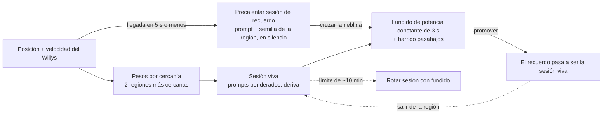

# Willys por Colombia

[English](README.md) · **Español**

**Un juego de manejo en un diorama de juguete donde la música de Lyria RealTime se va a la deriva mientras manejas, y cada región recuerda su propio tema.**

## Jugar

**Demo en vivo: muy pronto en Vercel.** Mientras tanto, córrelo en local en dos minutos (ver [Córrelo en local](#córrelo-en-local)).

Tres formas de jugar:

1. **Con tu propia API key** (la experiencia completa, música de Lyria RealTime en vivo). Consigue una key gratis en [Google AI Studio](https://aistudio.google.com/apikey), pégala en la pantalla de inicio y haz clic. La key se queda en tu navegador (sessionStorage; localStorage solo si marcas "Recordar"), va directo de tu navegador a Google y no pasa por ningún servidor. El SDK web de Lyria viaja con el juego (`public/vendor/`), así que ningún código de terceros cargado desde un CDN puede ver tu key.
2. **Sin key** ("Jugar sin key (música de Spotify)" en la pantalla de inicio, o `?nokey=1`). Manejas el mismo mundo, pero no se abre ninguna sesión de Lyria: un reproductor pequeño pone la playlist de Spotify de la región a la que entras. Sin sesión de Spotify en tu navegador suenan vistas previas de 30 segundos. El A/B de Memoria (`M`) necesita Lyria, así que en este modo está apagado.
3. **Local con servidor** (modo de desarrollo). `npm start` levanta un proxy Node con una sola key central en `.env`; abre <http://localhost:3000/?server=1>. Mira [Córrelo en local](#córrelo-en-local) y [docs/DEVELOPMENT.md](docs/DEVELOPMENT.md).

**Controles:** teclado (`W A S D` / flechas, `Space` freno de mano), o en el celular **en horizontal** un joystick flotante (por defecto) o botones de flechas, que se cambian con el botón pequeño bajo el minimapa. El **botón del ojo** (o `H`) activa el modo observador: oculta toda la interfaz para que solo manejes y mires. La lista completa está en [Controles](#controles).

> Proyecto independiente, sin afiliación ni respaldo de Google.


Un jeep Willys de caficultor recorre una Colombia en miniatura. Mientras manejas, la música generada en vivo por
[Lyria RealTime](https://ai.google.dev/gemini-api/docs/music-generation) se mezcla según la cercanía a cada región y
poco a poco **se va a la deriva**: la música olvida. Cuando cruzas la neblina en el borde de una región, una sesión nueva
de Lyria con la semilla de esa región toca su tema **idéntico, siempre**: el mapa recuerda. Presiona `M` para activar y
desactivar la Memoria y escuchar la diferencia.

## Por qué

[@googledevs](https://x.com/googledevs/status/2107178170218655865) compartió una demo de Michael Joffe
([@mwjoffe](https://x.com/mwjoffe)): un prado en 3D musicalizado con Lyria RealTime. Yo pregunté:

> Adaptive soundtracks are what game composers have been faking for years with stems and crossfades. Does Lyria keep a theme over time, or does the music drift as you walk around? That's the hard part with generative music.
>
> *Las bandas sonoras adaptativas son lo que los compositores de videojuegos llevan años simulando con stems y fundidos cruzados. ¿Lyria mantiene un tema a lo largo del tiempo, o la música se va a la deriva mientras caminas? Esa es la parte difícil de la música generativa.*

La respuesta de Michael:

> It follows a theme in this particular demo. Give it a try yourself, would love to see what you build.
>
> *En esta demo en particular sigue un tema. Pruébalo tú mismo, me encantaría ver qué construyes.*

Este proyecto es esa prueba. Mide cómo se comporta Lyria RealTime con el paso del tiempo y luego convierte el resultado
en una mecánica de juego: **la carretera es deriva, la región es memoria.**

## Cómo funciona

- **En la carretera (deriva).** Una sesión viva de Lyria recibe prompts ponderados. Las dos regiones más cercanas pesan más
  (distancia inversa, acentuada), así que el estilo se mezcla a medida que te mueves. Si la dejas sola, la música se aleja de donde empezó.
- **En una región (memoria).** Poco antes de que llegues, se precalienta una segunda sesión con el prompt y la semilla de
  esa región y se mantiene en silencio. La neblina tapa los ~4 s que Lyria necesita para arrancar. Cuando la cruzas, un
  fundido cruzado (crossfade) de potencia constante de 3 s (con un barrido de filtro pasabajos) le pasa el control a la sesión de recuerdo, que se
  convierte en la nueva sesión viva.
- **Dentro de una región.** Las secciones (+25 s, +50 s, ciclo de 90 s) cambian los pesos de los prompts para que un tema no se repita mecánicamente.
- **Memoria apagada (`M`).** Sin sesiones de recuerdo: solo oyes la mezcla viva, a la deriva. Volver a un lugar ya no suena igual.



Por defecto el navegador se conecta directo a Lyria con la key del jugador (los tokens efímeros no funcionan con
Lyria RealTime, pero la key de Gemini sí conecta desde el navegador; mira "Jugar"). El proxy WebSocket en Node
queda como modo de desarrollo, con una sola llave central en el servidor (`?server=1`).

### Hechos medidos (oct 2026)

| Qué | Resultado |
|---|---|
| Formato de audio | PCM16, 48 kHz, estéreo, bloques de unos 2 s |
| Primer audio tras conectarse | unos 3.5 a 4 s |
| Cambio de prompt | audible tras ~1.3 a 1.8 s (percibido 2 a 4 s) |
| Determinismo | misma semilla + prompt + config da audio idéntico bit a bit entre sesiones |
| Deriva con un prompt fijo | la similitud de croma frente a los primeros 20 s baja de 0.95 a entre 0.65 y 0.8 |
| Prueba de recuerdo | volver con una sesión nueva con semilla: 0.998 de similitud; sin memoria: 0.79 |
| Límite de sesión | se cierra a los ~601 s (código 1011), por eso las sesiones rotan con un fundido |
| Recuperación | si el live se cae solo (red, corte sin rotar, hipo), el cliente lo reabre con la mezcla actual y backoff 1/2/4/8 s; agotado, deja una nota fija con el motivo |
| `bpm` / `scale` | solo cambian con `resetContext` |

Entonces, para responder la pregunta original: por sí sola, **Lyria se va a la deriva**. Un tema solo se mantiene si lo
reancla con la misma semilla, prompt y config. Los experimentos crudos están en [`experiments/`](experiments/) (`FASE0.md`, `RONDA2.md`, `MEDELLIN.md`).

## Regiones

Seis mini-ciudades, cada una con su propio prompt y semilla (mira [`places.json`](public/places.json)). Aquí los prompts van resumidos.

| Región | Género | Ícono 3D | Prompt (resumido) | Semilla | Spotify |
|---|---|---|---|---|---|
| Caribe | Vallenato | Pájaro-acordeón gigante, sombrero vueltiao, flamencos, palenquera, Cartagena | Melodía de acordeón de botones, caja vallenata, guacharaca, bajo | 7 | [playlist](https://open.spotify.com/playlist/4nKQboO11Kz73pNOeNCqoF) |
| Pacífico | Folclor afrocolombiano del Pacífico | Ballenas jorobadas, casas palafíticas, marimba de chonta, rana dorada | Ostinato de marimba de chonta, bombo en 6/8, cununos, llamada y respuesta | 7 | [playlist](https://open.spotify.com/playlist/6IBpUAb1JxbGbDUI3ufd4a) |
| Santander | Guabina andina | Hormiga culona gigante, Barichara, teleférico del Chicamocha, parapentes | Dueto de tiple y requinto, trémolo de bandola, lento y melancólico | 7 | [playlist](https://open.spotify.com/playlist/72uVKpMHHBQ8B6BCxHyFU7) |
| Llanos | Joropo | Caño de colores, chigüiros, llanero a caballo, morichales | Arpa llanera, cuatro, maracas, galopando | 7 | [playlist](https://open.spotify.com/playlist/4qS4pHQE04evHUzox2hjBw) |
| Cali | Salsa | Cristo Rey, tarima de salsa, gato en el río | Arreglo de metales, piano montuno, congas, timbales | 7 | [playlist](https://open.spotify.com/playlist/0rBAzF0Rb6zb2kGNQVpMsg) |
| Medellín | Afro house melódico (122 bpm) | Metrocable, Comuna 13, silleteros | Percusión orgánica, bajo rodante, pads cálidos, melodía de sintetizador pulsado | 11 | [playlist](https://open.spotify.com/playlist/3g4NM902tQmcwiuxsefq0Y) |

Estas playlists son las que suenan en el modo sin key.

## Galería

| | |
|---|---|
|  |  |
|  |  |
|  |  |


La estética es un "diorama de juguete a la hora dorada" con ciclo de día. Todo es procedural (sin modelos ni texturas) en three.js r160.

## Córrelo en local

Requisitos: Node 20+. Para la música de Lyria en vivo necesitas además una API key de Gemini de [Google AI Studio](https://aistudio.google.com/apikey) (el plan gratuito funciona); sin ella igual puedes manejar con las playlists de Spotify (`?nokey=1`).

```bash
npm install
npm run static              # modo estático (el que se despliega): http://127.0.0.1:4000
```

Abre <http://127.0.0.1:4000>, pega tu key (o elige "Jugar sin key") y haz clic para empezar. También hay modo servidor clásico (la llave vive en el servidor y el navegador no pide nada): define `GEMINI_API_KEY` en `.env` con `cp .env.example .env`, corre `npm start` y abre <http://localhost:3000/?server=1>. Notas:

- Usa **una sola pestaña** del navegador (cada pestaña abre sus propias 2 sesiones de Lyria; en modo servidor una conexión nueva cierra la anterior).
- Cada jugador usa **2 sesiones de Lyria** (viva + recuerdo).
- Lyria RealTime es un modelo experimental (`models/lyria-realtime-exp`), así que las cuotas y el comportamiento pueden cambiar.

### Desplegar (sin servidor)

`public/` es un sitio 100% estático y sin build, así que se puede alojar tal cual. El repo incluye un `vercel.json`
(output directory `public`): importa el repo en Vercel, framework "Other", sin comando de build. Cualquier otro hosting
estático también sirve. Cada jugador trae su propia key (mira [Jugar](#jugar)); en el servidor no se guarda nada. Lyria
RealTime es experimental: cada persona necesita acceso al modelo con su key. three.js y las fuentes se cargan desde CDN
públicos; el SDK de Lyria no (está vendorizado en `public/vendor/`).

## Controles

| Tecla | Acción |
|---|---|
| `W A S D` / flechas | Manejar |
| `Space` | Freno de mano |
| `M` | Memoria activada/desactivada (el A/B; necesita Lyria, apagada en el modo sin key) |
| `N` | Mapa grande |
| `P` | Pausa |
| `T` | Avanzar la hora del día |
| `H` o el **botón del ojo** | Modo observador: oculta el HUD, el minimapa, las ayudas y las tarjetas; solo quedan el ojo (tenue) y, en táctil, los controles de manejo |
| `F` | FPS |

**Celular (horizontal).** Los controles táctiles aparecen solos (en vertical sale el aviso "Gira el celular"). Hay dos modos, que se cambian con el botón pequeño bajo el minimapa y quedan guardados en tu navegador:

- **Joystick (por defecto):** un joystick analógico aparece donde apoyas el pulgar en la mitad izquierda (arriba = acelerar, abajo = frenar y luego reversa, a los lados = dirigir) y un botón grande de **Freno de mano** abajo a la derecha.
- **Flechas:** botones ◀ ▶ abajo a la izquierda para dirigir, y Freno/Reversa, Acelerar y Freno de mano abajo a la derecha.

Los botones de Mapa, Memoria y Pausa van bajo el minimapa. Para probar en el PC: `?touch=1` y `?touchmode=joystick|flechas`.

## Estructura del proyecto

```
server.mjs, server-core.mjs   Modo servidor de desarrollo: proxy Node + ws hacia Lyria (una llave central)
public/
  core.mjs                    Máquina de estados de las 2 sesiones Lyria (compartida servidor/navegador)
  local-link.js, key-store.js El link directo navegador→Lyria y la key del jugador
  vendor/                     SDK web de Google vendorizado (build ESM autocontenido; sin respaldo por CDN)
  places.json                 Regiones: prompt, semilla, bpm, secciones, playlist de Spotify
  index.html, game.js         El bucle del juego y el HUD
  touch.js, spotify.js        Controles táctiles (joystick / flechas) y la lógica del reproductor de Spotify sin key
  audio.js, audio-core.js     Web Audio: colas, retención, fundido de potencia constante, barrido pasabajos
  memory.js, sections.js      Pesos por cercanía, lógica de precalentar / entrar / salir, secciones dentro de la región
  session-state.js            Estado de los canales y traspaso
  vehicle.js, willys.js       Manejo arcade y el jeep
  world/                      Terreno procedural, carreteras, regiones, props, cielo, ciclo de día
experiments/                  Scripts y notas detrás de los hechos medidos (los WAV no se suben al repo)
test-*.mjs                    Pruebas
docs/DEVELOPMENT.md           Notas técnicas: protocolo, decisiones, mundo y física
PLAN.md, ESTILO.md            Plan de diseño y dirección de arte (en español)
```

## Pruebas

```bash
npm test            # 18 suites: pruebas unitarias y de simulación con Lyria simulado (sin llamadas a la API)
npm run test:real   # corre contra la API real de Lyria; gasta cuota, requiere GEMINI_API_KEY
```

## Hoja de ruta

- Un mapamundi más allá de Colombia.

Las notas técnicas completas (protocolo WebSocket, decisiones de diseño, mundo, física, rendimiento) están en [docs/DEVELOPMENT.md](docs/DEVELOPMENT.md).

## Créditos

- [Lyria RealTime](https://deepmind.google/models/lyria/) de Google DeepMind, a través de la Gemini API.
- [three.js](https://threejs.org/).
- Fuentes [Fredoka](https://fonts.google.com/specimen/Fredoka) y [Nunito](https://fonts.google.com/specimen/Nunito) (Google Fonts, OFL).
- Inspiración visual: [Messenger](https://messenger.abeto.co/) de Abeto.
- La demo original que inició el hilo: Michael Joffe ([@mwjoffe](https://x.com/mwjoffe)).

Hecho por Nicolás ([@Nicolas6879](https://github.com/Nicolas6879)), saxofonista y desarrollador de Colombia.

Proyecto independiente, sin afiliación ni respaldo de Google. Lyria y Gemini son marcas de Google.

## Licencia

MIT, mira [LICENSE](LICENSE).
