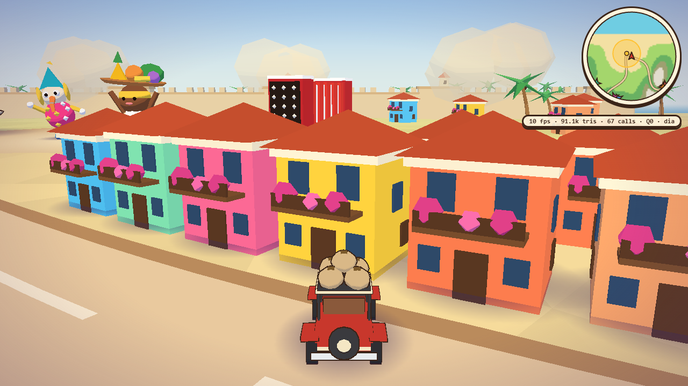
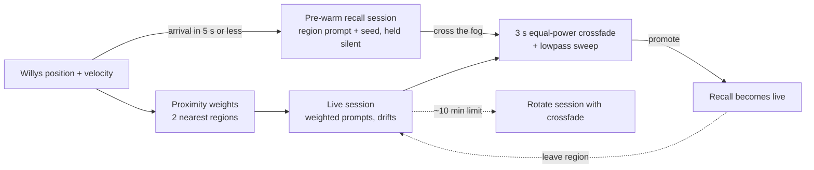
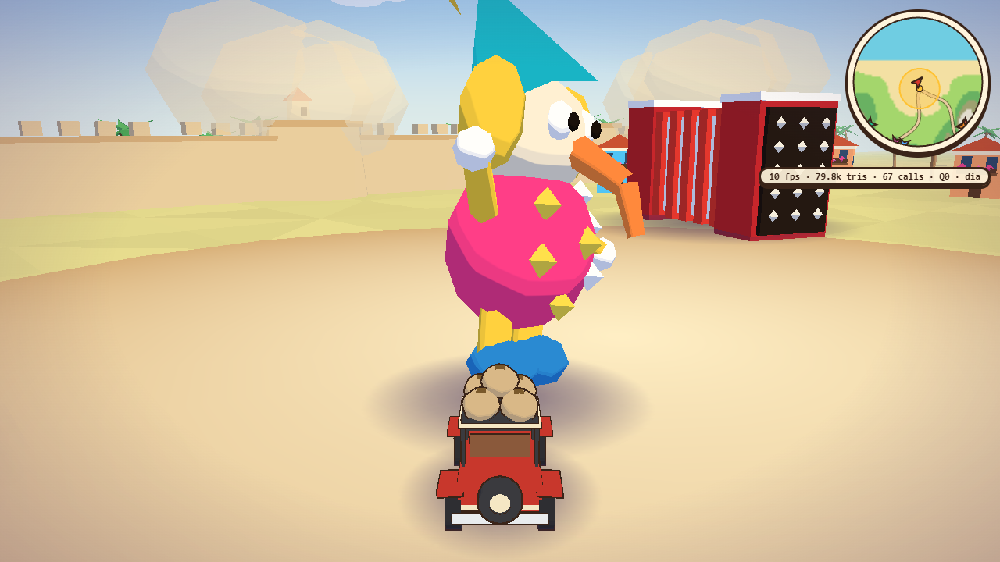
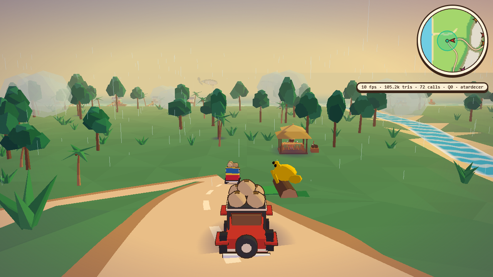
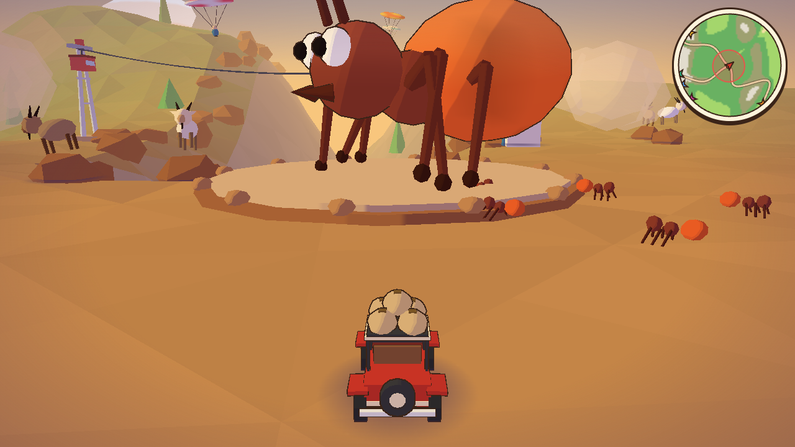
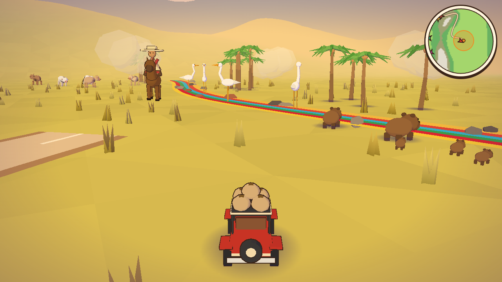
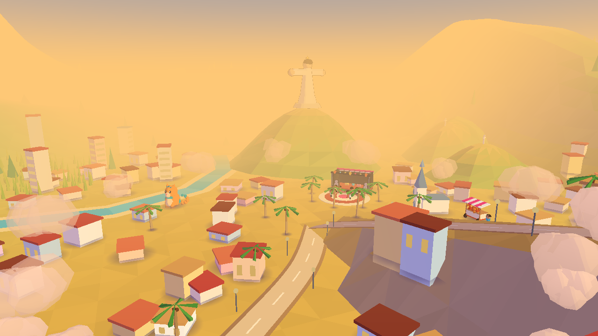
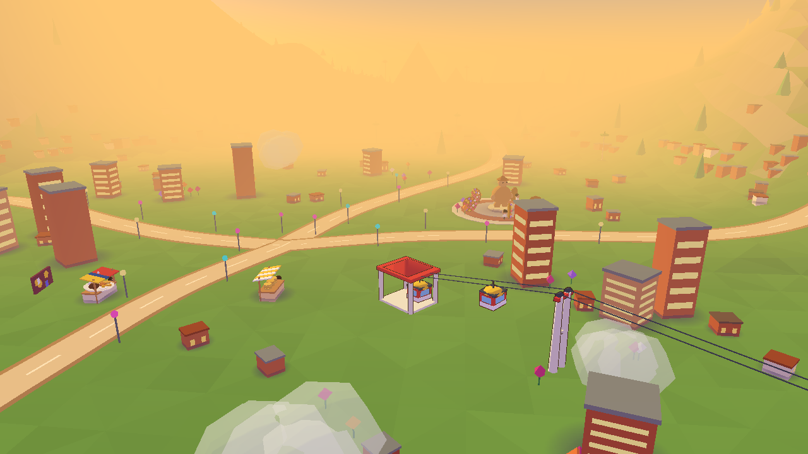
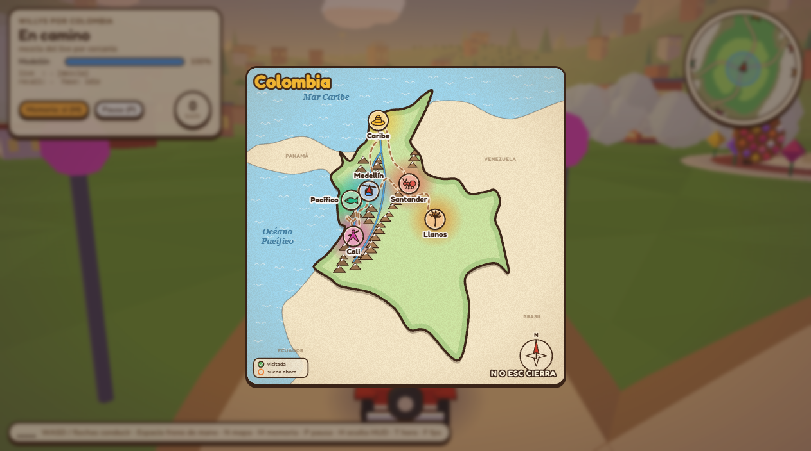
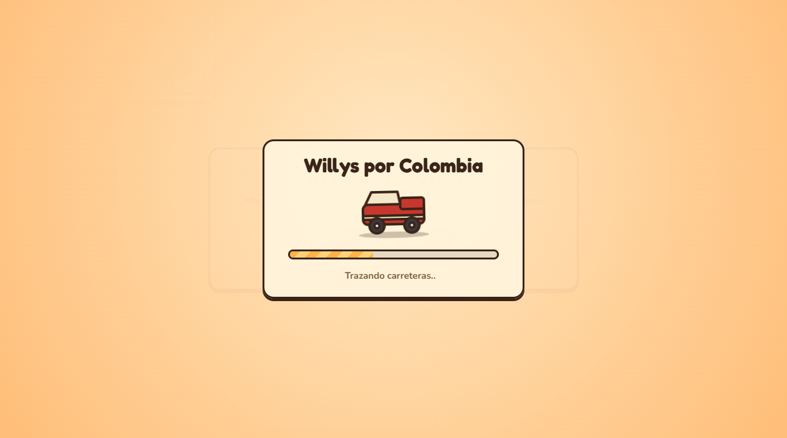

# Willys por Colombia

**English** · [Español](README.es.md)

**A toy-diorama driving game where Lyria RealTime music drifts as you drive, and every region remembers its own theme.**

## Play

**[Play it now: willys-por-colombia.vercel.app](https://willys-por-colombia.vercel.app)**

Three ways to play:

1. **With your own API key** (full experience, live Lyria RealTime music). Get a free key at [Google AI Studio](https://aistudio.google.com/apikey), paste it on the start screen and click. The key stays in your browser (sessionStorage; localStorage only if you tick "Remember"), goes straight from your browser to Google and never touches a server. The Lyria web SDK ships with the game (`public/vendor/`), so no third-party code loaded from a CDN can see your key.
2. **Without a key** ("Play without a key (Spotify music)" on the start screen, or `?nokey=1`). You drive the same world, but no Lyria session is opened: a small player plays the Spotify playlist of the region you enter. Without a Spotify session in your browser you hear 30-second previews. The Memory A/B (`M`) needs Lyria, so it is off in this mode.
3. **Local with a server** (developer mode). `npm start` runs a Node proxy that holds one central key in `.env`; open <http://localhost:3000/?server=1>. See [Run it locally](#run-it-locally) and [docs/DEVELOPMENT.md](docs/DEVELOPMENT.md).

**Controls:** keyboard (`W A S D` / arrows, `Space` handbrake), or on a phone held **horizontally** a floating joystick (default) or arrow buttons, switchable from the small button under the minimap. The **eye button** (or `H`) turns on observer mode: it hides all the UI so you can just drive and look. Full list in [Controls](#controls).

> Independent project, not affiliated with or endorsed by Google.




A coffee-farmer Willys jeep drives through a miniature Colombia. While you drive, music generated live by
[Lyria RealTime](https://ai.google.dev/gemini-api/docs/music-generation) is mixed by proximity to each region and
slowly **drifts**: the music forgets. When you cross the fog at the edge of a region, a fresh Lyria session with that
region's seed plays its theme **identically, every time**: the map remembers. Press `M` to switch Memory on and off and
hear the difference.

## Why

[@googledevs](https://x.com/googledevs/status/2107178170218655865) shared a demo by Michael Joffe
([@mwjoffe](https://x.com/mwjoffe)): a 3D meadow scored by Lyria RealTime. I asked:

> Adaptive soundtracks are what game composers have been faking for years with stems and crossfades. Does Lyria keep a theme over time, or does the music drift as you walk around? That's the hard part with generative music.

Michael's answer:

> It follows a theme in this particular demo. Give it a try yourself, would love to see what you build.

This project is that try. It measures how Lyria RealTime behaves over time, and then turns the result into a game
mechanic: **the road is drift, the region is memory.**

## How it works

- **On the road (drift).** One live Lyria session receives weighted prompts. The two nearest regions get the most weight
  (inverse-distance, sharpened), so the style blends as you move. Left alone, the music wanders away from where it began.
- **At a region (memory).** Shortly before you arrive, a second session is pre-warmed with that region's prompt and seed
  and held silent. The fog covers the ~4 s Lyria needs to start. As you cross it, a 3 s equal-power crossfade (with a
  lowpass sweep) hands over to the recall session, which becomes the new live session.
- **Inside a region.** Sections (+25 s, +50 s, 90 s cycle) shift prompt weights so a theme does not loop mechanically.
- **Memory off (`M`).** No recall sessions: you get only the live, drifting mix. Going back to a place no longer sounds the same.



By default the browser connects straight to Lyria with the player's key (ephemeral tokens do not work with Lyria
RealTime, but a Gemini key does connect from the browser; see "Play"). The small Node WebSocket proxy stays
as a dev mode with a single central key on the server (`?server=1`).

### Measured facts (Oct 2026)

| What | Result |
|---|---|
| Audio format | PCM16, 48 kHz, stereo, blocks of about 2 s |
| First audio after connecting | about 3.5 to 4 s |
| Prompt change | audible after ~1.3 to 1.8 s (perceived 2 to 4 s) |
| Determinism | same seed + prompt + config gives bit-identical audio across sessions |
| Drift with a fixed prompt | chroma similarity vs. the first 20 s falls from 0.95 to 0.65 to 0.8 |
| Recall test | returning with a fresh seeded session: 0.998 similarity; without memory: 0.79 |
| Session limit | closes at about 601 s (code 1011), so sessions rotate with a crossfade |
| Recovery | if the live session dies on its own (network, 601 s cap not rotated, hiccup), the client reopens it with the current mix and 1/2/4/8 s backoff; if it runs out, it leaves a fixed note with the reason |
| `bpm` / `scale` | only change with `resetContext` |

So, to answer the original question: on its own, **Lyria drifts**. A theme is kept only by re-anchoring it with the same
seed, prompt and config. The raw experiments are in [`experiments/`](experiments/) (`FASE0.md`, `RONDA2.md`, `MEDELLIN.md`).

## Regions

Six mini-cities, each with its own prompt and seed (see [`places.json`](public/places.json)). Prompts are shortened here.

| Region | Genre | 3D icon | Prompt (short) | Seed | Spotify |
|---|---|---|---|---|---|
| Caribe | Vallenato | Giant accordion bird, sombrero vueltiao, flamingos, palenquera, Cartagena | Button accordion melody, caja vallenata, guacharaca, bass | 7 | [playlist](https://open.spotify.com/playlist/4nKQboO11Kz73pNOeNCqoF) |
| Pacífico | Afro-Colombian Pacific folk | Humpback whales, stilt houses, marimba de chonta, golden frog | Marimba de chonta ostinato, bombo on 6/8, cununos, call and response | 7 | [playlist](https://open.spotify.com/playlist/6IBpUAb1JxbGbDUI3ufd4a) |
| Santander | Andean guabina | Giant culona ant, Barichara, Chicamocha cable car, paragliders | Tiple and requinto duet, bandola tremolo, slow and melancholic | 7 | [playlist](https://open.spotify.com/playlist/72uVKpMHHBQ8B6BCxHyFU7) |
| Llanos | Joropo | Colored caño, capybaras, llanero on horseback, morichales | Arpa llanera, cuatro, maracas, galloping | 7 | [playlist](https://open.spotify.com/playlist/4qS4pHQE04evHUzox2hjBw) |
| Cali | Salsa | Cristo Rey, salsa stage, cat in the river | Brass arrangement, montuno piano, congas, timbales | 7 | [playlist](https://open.spotify.com/playlist/0rBAzF0Rb6zb2kGNQVpMsg) |
| Medellín | Melodic afro house (122 bpm) | Metrocable, Comuna 13, silleteros | Organic percussion, rolling bass, warm pads, plucked synth melody | 11 | [playlist](https://open.spotify.com/playlist/3g4NM902tQmcwiuxsefq0Y) |

These playlists are what plays in the no-key mode.

## Gallery

| | |
|---|---|
|  |  |
|  |  |
|  |  |





The look is a "toy diorama at golden hour" with a day cycle. Everything is procedural (no models or textures) in three.js r160.

## Run it locally

Requirements: Node 20+. For the live Lyria music you also need a Gemini API key from [Google AI Studio](https://aistudio.google.com/apikey) (the free tier works); without one you can still drive with the Spotify playlists (`?nokey=1`).

```bash
npm install
npm run static              # static mode (the one you deploy): http://127.0.0.1:4000
```

Open <http://127.0.0.1:4000>, paste your key (or pick "Play without a key") and click to start. There is also the classic server mode (the key lives on the server and the browser asks for nothing): set `GEMINI_API_KEY` in `.env` with `cp .env.example .env`, run `npm start` and open <http://localhost:3000/?server=1>. Notes:

- Use **one browser tab** only (each tab opens its own 2 Lyria sessions; in server mode a new connection closes the previous one).
- Each player uses **2 Lyria sessions** (live + recall).
- Lyria RealTime is an experimental model (`models/lyria-realtime-exp`), so quotas and behavior may change.

### Deploy (no server)

`public/` is a fully static site with no build step, so it can be hosted as-is. The repo includes a `vercel.json`
(output directory `public`): import the repo in Vercel, framework "Other", no build command. Any other static host
works too. Every player brings their own key (see [Play](#play)); nothing is stored on the server. Lyria RealTime is
experimental: each person needs access to the model with their own key. three.js and the fonts load from public CDNs;
the Lyria SDK does not (it is vendored in `public/vendor/`).

## Controls

| Key | Action |
|---|---|
| `W A S D` / arrows | Drive |
| `Space` | Handbrake |
| `M` | Memory on/off (the A/B; needs Lyria, off in no-key mode) |
| `N` | Big map |
| `P` | Pause |
| `T` | Advance time of day |
| `H` or the **eye button** | Observer mode: hides the HUD, minimap, hints and cards; only the eye (faded) and, on touch, the driving controls stay |
| `F` | FPS |

**Phones (landscape).** Touch controls appear by themselves (portrait shows a "rotate your phone" notice). Two modes, switched with the small mode button under the minimap and remembered in your browser:

- **Joystick (default):** one analog joystick appears where you put your thumb on the left half (up = gas, down = brake then reverse, sideways = steer) and a big **Handbrake** button sits bottom-right.
- **Arrows:** ◀ ▶ buttons bottom-left to steer, and Brake/Reverse, Accelerate and Handbrake bottom-right.

Map, Memory and Pause buttons sit under the minimap. For testing on a PC: `?touch=1`, and `?touchmode=joystick|flechas`.

## Project structure

```
server.mjs, server-core.mjs   Dev server mode: Node + ws proxy to Lyria (one central key)
public/
  core.mjs                    State machine for the 2 Lyria sessions (shared by server/browser)
  local-link.js, key-store.js Direct browser→Lyria link and the player's key
  vendor/                     Vendored Google web SDK (self-contained ESM build; no CDN fallback)
  places.json                 Regions: prompt, seed, bpm, sections, Spotify playlist
  index.html, game.js         The game loop and HUD
  touch.js, spotify.js        Touch controls (joystick / arrows) and the no-key Spotify player logic
  audio.js, audio-core.js     Web Audio: queues, hold, equal-power crossfade, lowpass sweep
  memory.js, sections.js      Proximity weights, pre-warm / enter / leave logic, in-region sections
  session-state.js            Channel state and handover
  vehicle.js, willys.js       Arcade driving and the jeep
  world/                      Procedural terrain, roads, regions, props, sky, day cycle
experiments/                  Scripts and notes behind the measured facts (WAV output is not committed)
test-*.mjs                    Tests
docs/DEVELOPMENT.md           Technical notes: protocol, decisions, world and physics (in Spanish)
PLAN.md, ESTILO.md            Design plan and art direction (in Spanish)
```

## Tests

```bash
npm test            # 18 suites: unit and simulation tests with a mocked Lyria (no API calls)
npm run test:real   # runs against the real Lyria API; uses quota, requires GEMINI_API_KEY
```

## Roadmap

- A world map ("mapamundi") beyond Colombia.

The full technical write-up (WebSocket protocol, design decisions, world, physics, performance) is in [docs/DEVELOPMENT.md](docs/DEVELOPMENT.md) (Spanish).

## Credits

- [Lyria RealTime](https://deepmind.google/models/lyria/) by Google DeepMind, through the Gemini API.
- [three.js](https://threejs.org/).
- Fonts [Fredoka](https://fonts.google.com/specimen/Fredoka) and [Nunito](https://fonts.google.com/specimen/Nunito) (Google Fonts, OFL).
- Visual inspiration: [Messenger](https://messenger.abeto.co/) by Abeto.
- The original demo that started the thread: Michael Joffe ([@mwjoffe](https://x.com/mwjoffe)).

Built by Nicolás ([@Nicolas6879](https://github.com/Nicolas6879)), saxophonist and developer from Colombia.

Independent project, not affiliated with or endorsed by Google. Lyria and Gemini are trademarks of Google.

## License

MIT, see [LICENSE](LICENSE).
